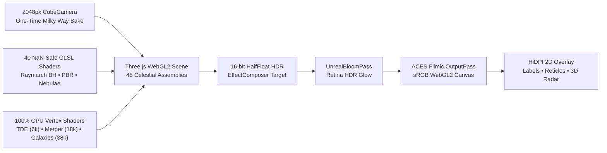

<!-- Animated Hero Wave Banner matching Berkin62232001 profile style -->
<p align="center">
  
</p>

<!-- Animated Typing Subtitle -->
<p align="center">
  
</p>

<!-- Interactive Action & Tech Stack Badges -->
<p align="center">
  <a href="https://berkin62232001.github.io/kozmos-3b-simulator/" target="_blank">
    
  </a>
  <a href="#-astrophysics-event-lab">
    
  </a>
  <a href="#-rendering--gpu-architecture">
    
  </a>
  <a href="#-türkçe-özet">
    
  </a>
</p>

<p align="center">
  
  
  
  
  
  
</p>

---

<!-- Animated Interactive-Feel SVG Showcase -->
<p align="center">
  <a href="https://berkin62232001.github.io/kozmos-3b-simulator/" target="_blank">
    
  </a>
</p>

> [!TIP]
> **Try it directly in your browser:** Click **Launch Live Simulator** above (or open `index.html` locally) — press **`T`** for the 6-stage Black Hole Tidal Disruption Event, **`M`** for the 18,000-star Milky Way–Andromeda Merger, or **`G`** to warp through a traversable wormhole!

---

## ✨ Key Visual & Physics Highlights

<table>
  <tr>
    <td width="50%" valign="top">
      <h3>🕳️ Real-Time GLSL Black Hole Raymarching</h3>
      <p>Gravitational light bending, thin photon ring, turbulent volumetric accretion disk, and relativistic Doppler beaming with empty-space skipping, pixel start dithering, and distance-adaptive step budgets (<code>52 / 36 / 24</code> steps).</p>
    </td>
    <td width="50%" valign="top">
      <h3>🔥 100% GPU Astrophysics Event Lab</h3>
      <p>Zero per-frame CPU particle loops and zero PCIe uploads. Both the <b>6,000-particle TDE</b> and <b>18,000-star Galaxy Merger</b> run entirely inside custom vertex shaders with live physics sliders and a sub-pixel 60/120 FPS timeline scrubber.</p>
    </td>
  </tr>
  <tr>
    <td width="50%" valign="top">
      <h3>🌍 Procedural PBR Planets &amp; Stars</h3>
      <p>Dynamic solar lighting, continents, specular oceans, night-side city lights, moving 3D cloud spheres, Rayleigh atmospheric scattering, screen-space <code>dFdx/dFdy</code> micro-bump relief, and analytical planet shadows cast onto Saturn &amp; J1407b rings.</p>
    </td>
    <td width="50%" valign="top">
      <h3>📡 3D Radar, Spatial Audio &amp; HiDPI HUD</h3>
      <p>Clickable HiDPI 3D mini radar, off-screen directional target pointers, procedural Web Audio API cosmic drone &amp; pulsar soundscape, collapsible HUD panels, and one-click HDR PNG snapshots (<code>P</code>).</p>
    </td>
  </tr>
</table>

---

## 🧠 Rendering & GPU Architecture



---

## 🔬 Astrophysics Event Lab

| Simulation | GPU Particles | Live Interactive Physics Controls | 6 Animated Stages |
| :--- | :---: | :--- | :--- |
| **Tidal Disruption Event (TDE)** | `6,000` | Penetration Factor **`β`** (`0.60–2.20`) · Black Hole Mass **`M_BH`** (`10⁵–10⁸ M☉`) | Approach → Roche Limit → Spaghettification → Self-Crossing Shock → Accretion Disk → Relativistic Jet |
| **Galaxy Merger (Milkomeda)** | `18,000` | Orbital Angle (`0.20–1.00`) · Mass Ratio **`M₂ / M₁`** (`0.30–1.00`) | First Approach → Tidal Bridge → Tidal Tails → Starburst Ignition → Dual-Core Coalescence → Elliptical Virialization |

---

## 📂 Interactive Deep Dives

<details>
<summary><b>🌌 Explore All 45 Celestial Bodies &amp; Systems (Click to Expand)</b></summary>
<br />

- **Black Holes, TDE &amp; Quasars:** TDE (`AT2019qiz / ASASSN-14li`), TON 618 Hyper-Luminous Quasar, M87* / Gargantua, Sagittarius A*, Cygnus X-1 (Roche-lobe X-ray binary), GW150914 Merging Binary Black Holes, Morris–Thorne Traversable Wormhole (Alpha &amp; Omega portals)
- **Extreme Stars &amp; Remnants:** Crab Pulsar (rotating polar beams), SGR 1806-20 Magnetar (3D magnetic dipole tubes), GW170817 Kilonova, SN 1987A Supernova (18 instanced cosmic pearls), Ring Nebula (M57), WR 102 &amp; Eta Carinae, Stephenson 2-18 Hypergiant, Sirius A &amp; B, Luhman 16 Brown Dwarf
- **Galaxies &amp; Nebulae:** Milky Way–Andromeda Merger (Milkomeda), Andromeda Spiral Galaxy (`20,000` GPU stars), Hoag's Ring Galaxy (`7,000` stars), Omega Centauri Globular Cluster (`7,000` stars), Orion Nebula &amp; Pillars of Creation (instanced volumetric clouds + Trapezium stars)
- **Solar System &amp; Exoplanets:** Sun, Mercury, Venus, Earth &amp; Moon, Mars, Asteroid Belt (`4,000` rocks), Jupiter &amp; Europa, Saturn &amp; Titan, Uranus, Neptune, Pluto, Halley's Comet, TRAPPIST-1 &amp; TRAPPIST-1e, HD 209458 b (Osiris), J1407b ("Super Saturn" 37-ring system)

</details>

<details>
<summary><b>⌨️ Controls &amp; Keyboard Shortcuts (Click to Expand)</b></summary>
<br />

| Action | Control |
| :--- | :--- |
| **360° Orbit / Camera Look** | Left Click + Drag |
| **Zoom In / Out** | Mouse Wheel / Trackpad Pinch |
| **6-DOF Free Flight** | `W`, `A`, `S`, `D` / Arrow Keys / `Q`, `E` |
| **Toggle Orbit Lock ↔ Free Flight** | `C` |
| **TDE / Galaxy Merger / Wormhole Jump** | `T` / `M` / `G` |
| **Warp Drive / Return to Sun** | `F` / `R` |
| **HDR Bloom / 3D Radar / Space Audio / Labels** | `B` / `N` / `V` / `L` |
| **Previous / Next Celestial Body** | `[` / `]` |
| **Quick Catalog Search** | `/` |
| **Save HDR Snapshot (PNG) / Hide HUD** | `P` / `H` |

</details>

<details>
<summary><b>⚡ Performance &amp; Security Engineering Specs (Click to Expand)</b></summary>
<br />

- **GPU-First Optimization:** One-time `2048px` Milky Way CubeMap bake, `InstancedMesh` batching (Orion Nebula &amp; SN 1987A), shared unit sphere geometries (`UNIT_SPHERE_HI/MED/LO/TINY`), cached 2D label widths, 3-frame radar throttling, and cross-browser Safari Metal / Chromium MSAA compatibility (`NaN`-guarded `safePow`/`safeNorm` across all 40 shaders).
- **Security Hardening:** 100% client-side with zero secrets or telemetry; strict `Content-Security-Policy` (`CSP`), `no-referrer`, pinned Three.js `0.170.0`, and zero `innerHTML` / `eval` usage.

</details>

<details id="-türkçe-özet">
<summary><b>🇹🇷 Türkçe Proje Özeti &amp; Hızlı Kurulum (Açmak için Tıklayın)</b></summary>
<br />

**Kozmos 3B Ultra**, hiçbir derleme (build) adımı gerektirmeyen, tek bir `index.html` dosyası içinde çalışan **WebGL2 (Three.js r170) + 16-bit HDR UnrealBloom + 40 özel GLSL shader** tabanlı etkileşimli 3B astrofizik simülatörüdür.

- **Gerçek Zamanlı Kara Delik Raymarching:** Kütleçekimsel mercekleme, foton halkası ve Doppler kaymalı hacimsel toplanma diski.
- **%100 GPU Olay Laboratuvarı:** 6 evreli TDE (6.000 parçacık) ve Galaksi Çarpışması (18.000 yıldız) canlı fizik parametreleriyle (`β`, `M_BH`, yörünge açısı, kütle oranı) kontrol edilebilir.
- **Çalıştırma:** Dosyayı doğrudan tarayıcıda açabilir veya GitHub Pages (`Settings → Pages → main / root`) ile anında yayınlayabilirsiniz.

</details>

---

## 🚀 Quick Start

No `npm install`, bundler, or build pipeline required:

```bash
git clone https://github.com/Berkin62232001/kozmos-3b-simulator.git
cd kozmos-3b-simulator
# Open index.html directly in any WebGL2 browser, or serve locally:
python3 -m http.server 8080
```

---

## 👨‍💻 Author

<p align="center">
  <b>Berkin Yılmaz</b> — Computer Vision Engineer &amp; AI/ML Researcher<br /><br />
  <a href="https://github.com/Berkin62232001" target="_blank">
    
  </a>
  <a href="https://linkbio-zeta-eight.vercel.app" target="_blank">
    
  </a>
</p>

<p align="center">
  
</p>
